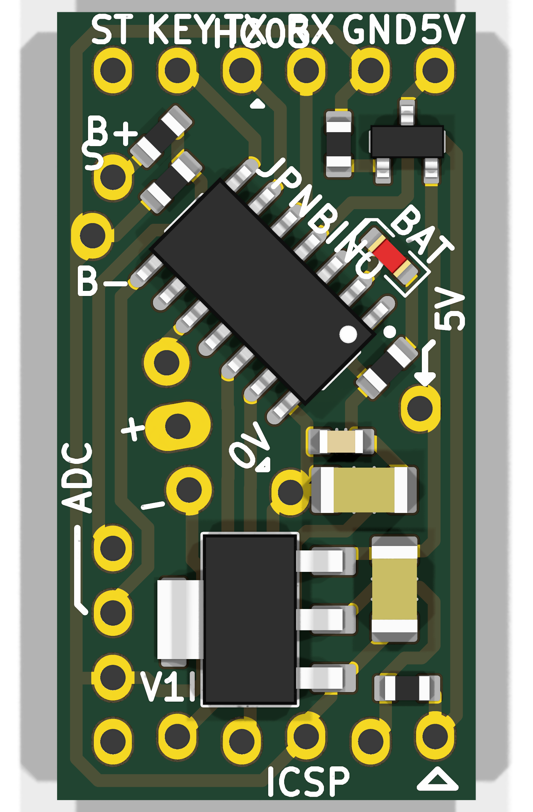
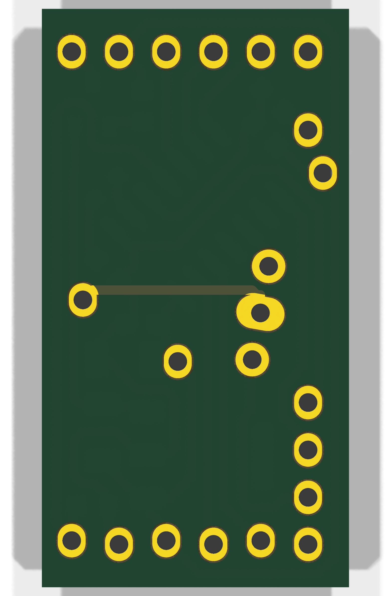

# ChicoServo - HW #

This is a fully working board which you may wanna use as reference or may clone and customize to your needs. The board was designed to an specific project which required ADC, PWM, SERIAL, and I/O connection.

Example firmware [**here**](https://bitbucket.org/jpnbino/fw_palhaservo/src/master/).

## PCB ##

(The original Altium renders are kept in `image/`.)

### Board details ###

|  Item           |Description |
|-----------------|------------|
| Core            | PIC16LF1824|
| Input Voltage (Vin)   |  4.75V ≤ Vin ≤ 10V    |
| Board Size      | 16.5mm x 31mm|
| User LED        | 1            |

### The project ###

* Quick summary

  * The project now lives in **KiCad 10** (`kicad/`). The original Altium Designer sources are **frozen** in `altium/` and are no longer maintained.

* Version

  * V1I1 - Initial.

### KiCad project ###

* Open `kicad/PALHASERVO.kicad_pro` with KiCad 10 (hierarchical schematic: root + sheets `01`..`05`; board `PALHASERVO.kicad_pcb`).
* Project libraries (referenced by `sym-lib-table` / `fp-lib-table`): `kicad/chico_servo.kicad_sym` and `kicad/chico_servo.pretty/`, converted from the libraries embedded in the Altium documents.
* Fabrication/documentation outputs are in `kicad/outputs/` (mirroring the Altium OutJob): schematic PDF, PCB/assembly PDFs, Gerbers + Excellon drill (`gerber/`), BOM CSV, pick-and-place CSV, STEP model and 3D renders (`images/`). Regenerate them with `kicad-cli` (File > Fabrication Outputs in the GUI).
* `kicad/tools/` holds the one-off conversion scripts (Altium PcbDoc/SchDoc -> KiCad). `kicad/tools/run_checks.sh` compares schematic and board connectivity.
* Conversion notes: the schematic was converted with a custom SchDoc reader (KiCad cannot import SchDoc headless); the Altium sheet template/title block was dropped, embedded pictures were downscaled, and PWR_FLAG / no-connect markers were added for ERC. Remaining ERC items are off-grid/dangling-wire warnings inherited from the Altium drawing; DRC has only silkscreen/library-override warnings.

### Video ####

I recorded this video when I was building the first prototype.

